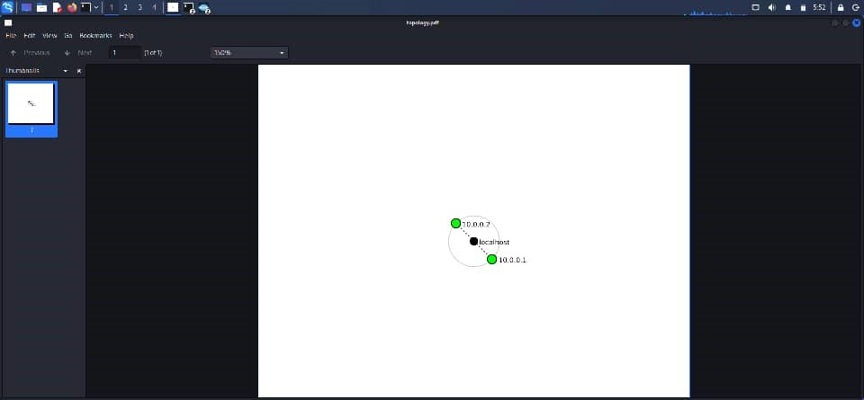

7# Week 2 tasks Google Dorking & Zenmap
Name: Jathweng Chol
# 1. Google Dorking - Live Cameras
Google Dork Used:
intitle:"webcamXP" inurl:8080
## Links
| 1 | intitle:"webcamXP" inurl:8080 | https://www.insecam.org/en/view/812476/ |
| 2 | intitle:"webcamXP" inurl:8080 | https://www.insecam.org/en/view/764128/ |
| 3 | intitle:"webcamXP" inurl:8080 | https://www.insecam.org/en/view/891134/ |
| 4 | intitle:"webcamXP" inurl:8080 | https://www.insecam.org/en/view/986159/ |
| 5 | intitle:"webcamXP" inurl:8080 | https://www.insecam.org/en/view/939565/ |
| 6 | intitle:"webcamXP" inurl:8080 | https://www.insecam.org/en/view/1012142/ |
| 7 | intitle:"webcamXP" inurl:8080 | https://www.insecam.org/en/view/1012139/ |
| 8 | intitle:"webcamXP" inurl:8080 | https://www.insecam.org/en/view/1011766/ |
| 9 | intitle:"webcamXP" inurl:8080 | https://www.insecam.org/en/view/1012155/ |
| 10 | intitle:"webcamXP" inurl:8080 | https://www.insecam.org/en/view/1012241/ |

## Zenmap

I got topology that shows 2 VPCs connected together.

VPC 1: 10.0.0.0/16
    - Subnet 10.0.1.0/24
    - Subnet 10.0.2.0/24
VPC 2: 10.1.0.0/16
    - Subnet 10.1.1.0/24
    - Subnet 10.1.2.0/24

## 3. Files in this Repo
Report.docx: https://docs.google.com/document/d/1oAyWgRnOu0WW9CjSqxyudeaRFhkQ2-E4RAItYiHylG8/edit?usp=sharing

Google-Dorking.docx: https://docs.google.com/document/d/1-7PK9D4UAa_IkmTrEVqZWSQdxkXhP03fRFSnxouwCHo/edit?usp=sharing
